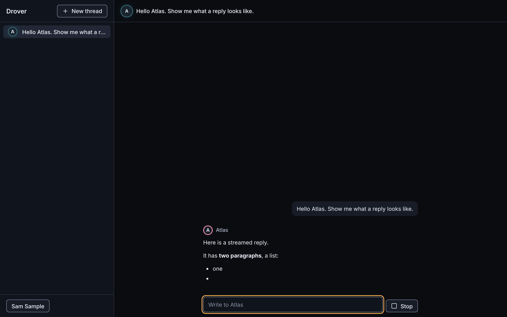
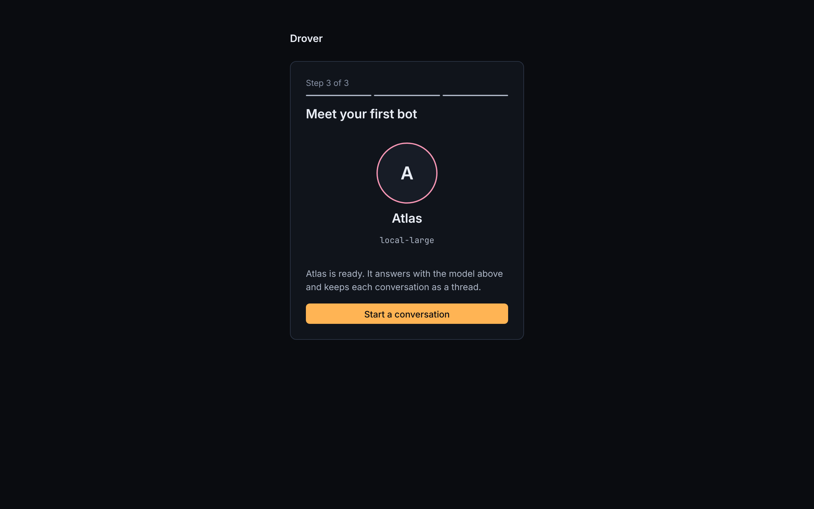
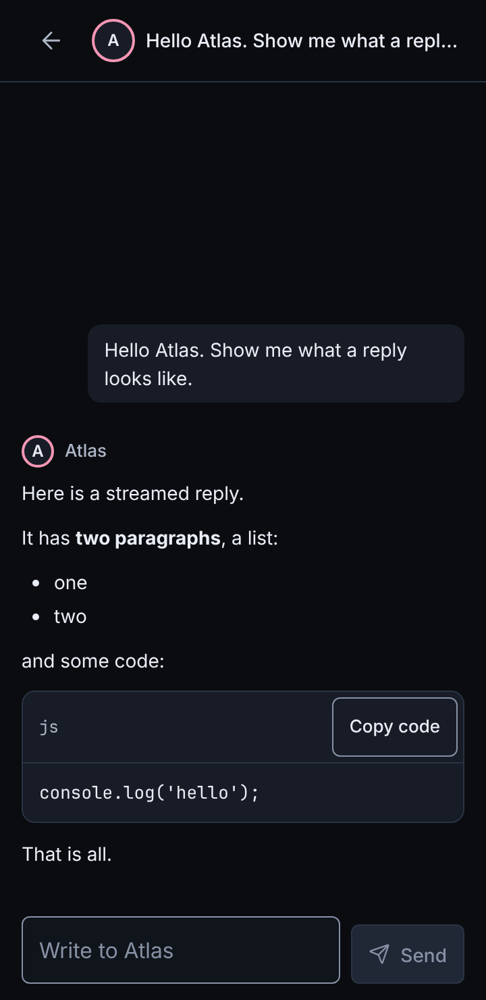

[**Apache License 2.0**](LICENSE) · Free to run, modify, and share

# Drover

**Run your own crew of AI bots.** Give each bot a job, connect your model, and decide which tools the bot can use. Drover runs on your own infrastructure and opens in a browser.

[Run it locally](#run-it-locally) · [See Drover in use](#see-drover-in-use) · [Follow development](ROADMAP.md)


## See Drover in use



In a thread, you can watch a reply arrive as the bot writes it. The visor lights up while the bot is working. On a phone, the thread fits a single column.

<table>
  <tr>
    <td width="63%" valign="top"><br/><strong>Meet your first bot.</strong> Set up your account and connect a model.</td>
    <td width="37%" valign="top"><br/><strong>Pick up a thread on your phone.</strong></td>
  </tr>
</table>

Drover is in early development. The screenshots show working development builds. Check the [roadmap](ROADMAP.md) for what’s still in flight.

## Run it locally

With Docker and Compose installed, clone this repository and run:

```sh
git clone https://github.com/Forrest-Technologies/drover.git
cd drover
docker compose up --build
```

Open [localhost:8080](http://localhost:8080). Compose builds the image from source, generates database credentials, and stores them in a volume across restarts. The default configuration listens on localhost.

<details>
<summary>Build and test with the .NET 11 SDK</summary>

```sh
dotnet build Drover.slnx -warnaserror
dotnet test --solution Drover.slnx
dotnet run --project src/Drover.Server
```

</details>

## Inside the project

- [Architecture](docs/architecture/README.md) and [decision records](docs/adr/README.md) explain how Drover is put together.
- [Interface design](DESIGN.md) describes the bot characters, live states, and light and dark themes.
- [Contributor guidance](AGENTS.md) and the [C# style guide](CODE_STYLE.md) cover changes to the repository.
- [Orchestration notes](docs/ORCHESTRATION.md) describe how the work is coordinated.

Drover is licensed under [Apache 2.0](LICENSE). See [NOTICE](NOTICE) for attribution.
