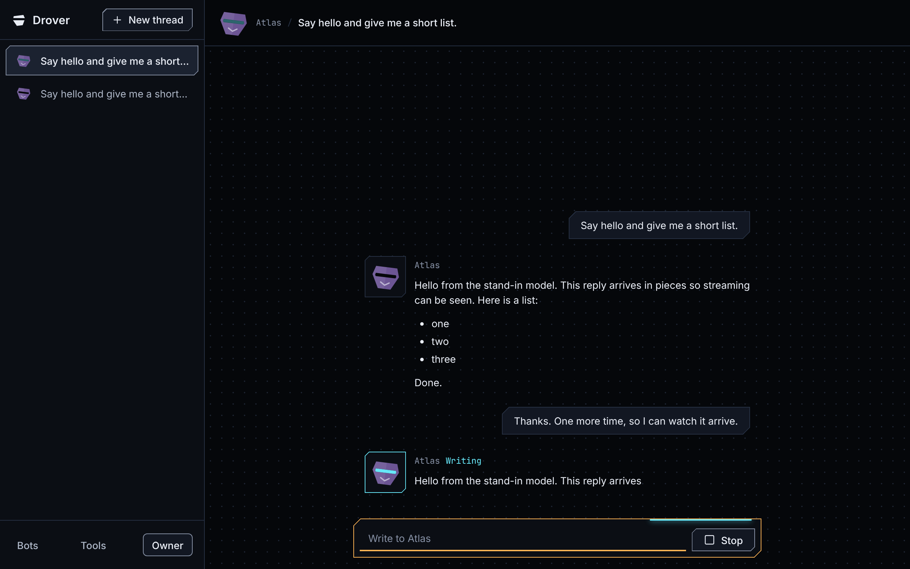
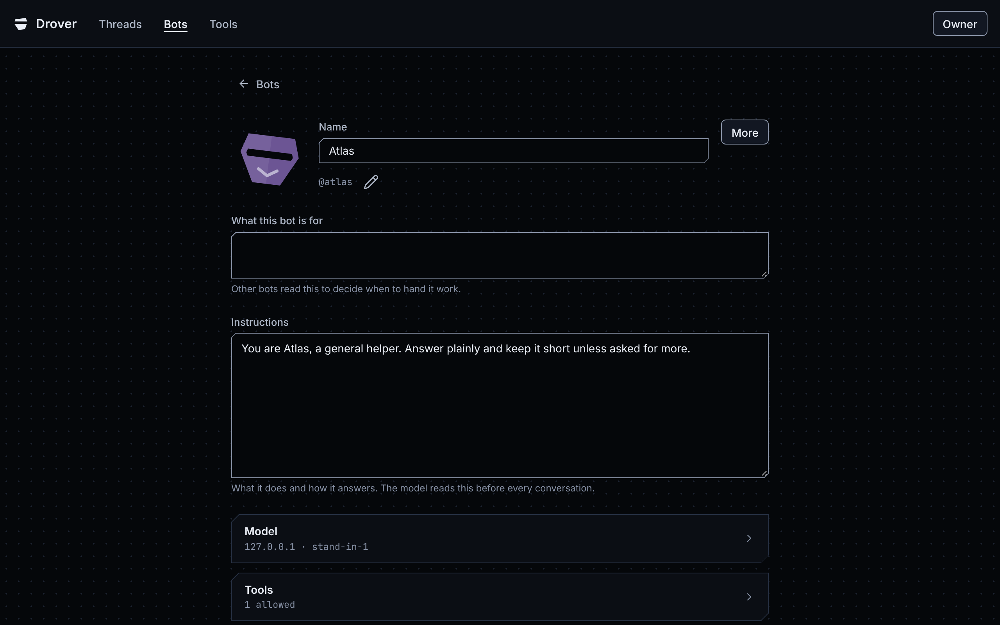
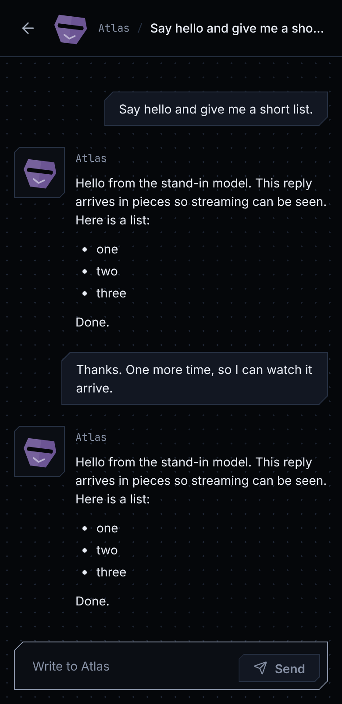
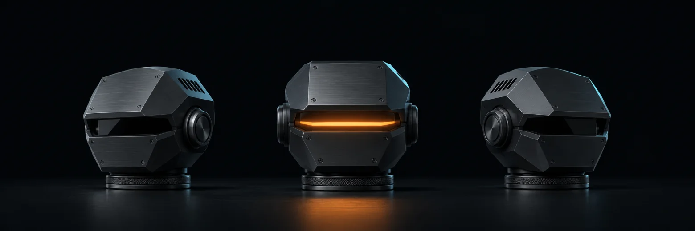

[**Apache License 2.0**](LICENSE) · [Quick start](#quick-start) · [Roadmap](ROADMAP.md)

# Drover

**Run your own crew of AI bots.** Host Drover on your own machine, connect a model provider, and talk to your bots from a desktop or phone browser.



Drover is in early development. You can run the browser app from source today. The native Android and Windows apps are on the [roadmap](ROADMAP.md).

## Quick start

Install Docker with Compose, then run:

```sh
git clone https://github.com/Forrest-Technologies/drover.git
cd drover
docker compose up --build
```

Open [localhost:8080](http://localhost:8080). Create your account and connect a model to start a conversation. Compose creates the database passwords on first startup and keeps them in Docker volumes. The default configuration listens on localhost.

## A closer look

<p>
  
  
</p>

Every bot is a character. Its visor lights up as it works, and it speaks from beside each reply. Make a bot yours in the editor, then choose which tools it may use. The same thread fits a single column on a phone.

<details>
<summary>Build and test with the .NET 11 SDK</summary>

```sh
dotnet build Drover.slnx -warnaserror
dotnet test --solution Drover.slnx
dotnet run --project src/Drover.Server
```

</details>

## Contributing

Start with the [roadmap](ROADMAP.md) and [contributor guidance](AGENTS.md). The [architecture](docs/architecture/README.md), [decision records](docs/adr/README.md), [interface design](DESIGN.md), [C# style guide](CODE_STYLE.md), and [orchestration notes](docs/ORCHESTRATION.md) explain how the project fits together.



See [LICENSE](LICENSE) and [NOTICE](NOTICE) for license and attribution details.
