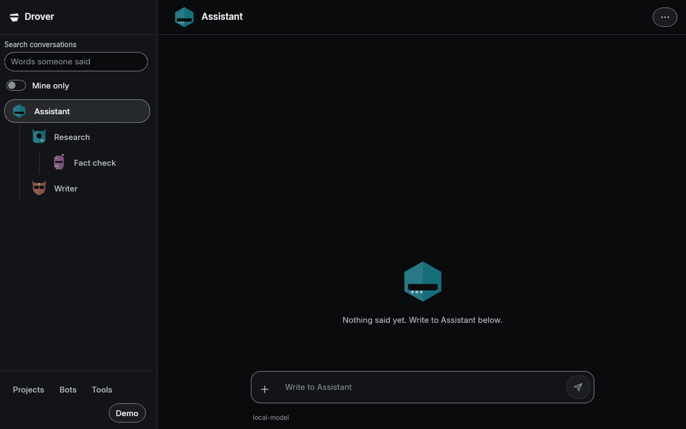
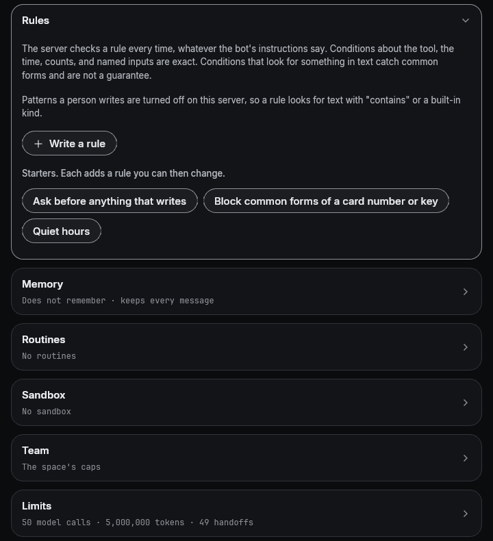
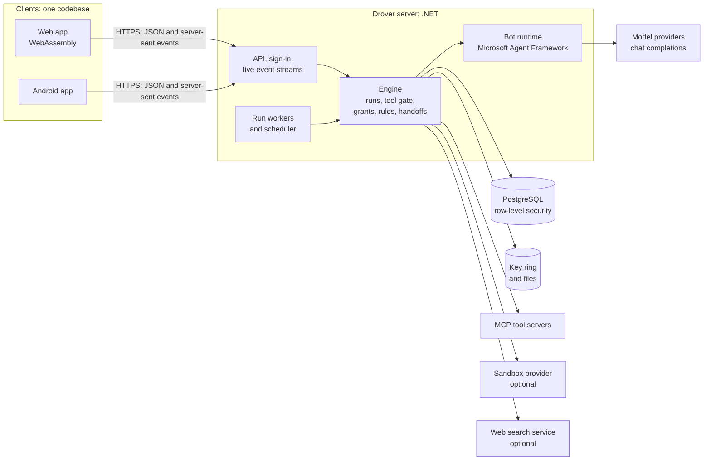

<p align="center">
  
</p>

<h1 align="center">Drover</h1>

<p align="center"><strong>A crew of AI bots you run on your own server.</strong></p>

<p align="center">
  <a href="https://github.com/Forrest-Technologies/drover/actions/workflows/ci.yml"></a>
  <a href="LICENSE"></a>
  <a href="https://github.com/Forrest-Technologies/drover/releases"></a>
</p>

> [!NOTE]
> Drover is early and a work in progress. Screens change from week to week, some features are half built, and you will find bugs. Issues, fixes, and pull requests are welcome. See [Contributing](#contributing).

<p align="center">
  <a href="#quick-start">Quick start</a> ·
  <a href="#features">Features</a> ·
  <a href="#security">Security</a> ·
  <a href="#architecture">Architecture</a> ·
  <a href="#roadmap">Roadmap</a> ·
  <a href="docs/self-hosting.md">Self-hosting guide</a>
</p>

Drover runs AI bots on a machine you control. You give each bot a model, instructions, the tools it may use, and a place under another bot. You talk to them from a browser or an Android phone. They can call MCP tool servers, read the web, keep notes about you, run on a schedule, and pass work to the bots below them. If you add a sandbox provider key, a bot also gets a machine of its own to run commands on.

The server holds the permissions. A bot can only call a tool you granted it, and Drover checks the grant again each time the bot calls it.

<p align="center">
  <picture>
    <source media="(prefers-color-scheme: light)" srcset="docs/images/readme/conversation-light.png" />
    
  </picture>
</p>

## The idea

We wanted an assistant we could change. Hosted assistants decide which tools you can connect, how long they keep your data, and what a bot is allowed to do. With Drover you decide those things, and the code is Apache 2.0, so you can read it and change it.

We keep the defaults strict around other people's data and your keys. Network access starts open so a model on your own network works on day one, and one setting closes it. We add new tools and protocols as they prove useful, each behind an interface Drover owns, so swapping a provider means changing one project.

## Features

This is what `main` does today. Planned work is in the [roadmap](#roadmap).

### Bots

Bots sit in a tree. The crew list on the left is how you move around: pick a bot and you land in its main conversation. A bot can hand a task to a bot below it and wait for the answer, and you can open that handoff and read it.

If you grant the crew tools, a bot can list, create, change, and remove the bots under it. Creating a bot always asks a person first. Each run has a cap on model calls and tokens, and a chain of handoffs stops at 5 levels or 50 runs unless you change the server's limits.

Each bot gets a character drawn from a set of parts (head, visor, top, mark, tilt, and color). The visor lights up while the bot thinks, writes, or runs a tool. The same state shows in words for screen readers and for anyone who turns motion off.

### Conversations

Replies stream in, and each tool call shows its arguments, output, and result as it happens. You can edit an earlier message, regenerate a reply, open a side chat next to the main one, and read a running summary.

Search covers your conversations, and you can save one as Markdown or JSON. Attach files and pictures; Drover reads PDF and office documents as text for the model. Projects group conversations around shared files. If you set up a second domain for previews, HTML a bot writes opens there, away from your session cookies.

### Tools

You can add any MCP server with no auth, a header (stored encrypted), or a sign-in. If a server changes a tool's definition, Drover marks that tool's grants for review.

Built in: current time, reading a web page, web search through a search service you point it at, memory notes, image creation through the bot's model, handoffs, and the crew tools.

Sandboxes are optional and need a provider key. With one, a bot can run commands, read and write files, and send a file back to you. A sandbox with a screen lets the bot look, click, type, and scroll, and hand the screen to you when a person has to act, for a sign-in for example. Each bot has a sandbox page where you can watch the screen, open a terminal, and pause, resume, rebuild, or turn it off.

### Models and cost

Use the built-in hosted provider, or any server that speaks the chat completions API, including one on your own network. You can set fallback models for a whole space or for one bot. The Usage screen shows cost per run and per bot.

### Memory, routines, rules, and extensions

- **Memory.** A bot keeps notes per person. You can read, edit, forget, and restore them from the conversation.
- **Routines.** A prompt plus a cron schedule and a time zone. Each run starts a new conversation or continues the last one.
- **Rules.** Per-bot rules that redact text, ask first, block a call, or stop the run. Starters cover "ask before anything that writes", card numbers and keys, and quiet hours.
- **Extensions.** One JSON file that adds a bot, a tool server, or both. You see what's in it before anything is added. It can't grant tools, and its bot starts paused.

### Apps

The web app is the same client code as the Android app, compiled to WebAssembly and served by the server at `/`. You can install it from the browser and turn on notifications.

The Android preview is a signed APK on the [releases page](https://github.com/Forrest-Technologies/drover/releases), for Android 7 or later. You can share text, links, pictures, and documents into Drover from other apps, and on Android 12 or later you can reply from a notification. Notifications go through a push distributor you choose; the [Android guide](docs/android-preview.md) has the setup.

## Security

We wrote Drover so that a bug in feature code shouldn't leak one person's data to another, and a prompt shouldn't be able to give a bot more than you granted.

| Concern | What Drover does |
| --- | --- |
| Isolation between people | Each row belongs to a space or a person, and PostgreSQL row-level security enforces that. The app's database role can't bypass the policies, and a test fails CI if a table has no policy. |
| What a bot may do | Drover only sends a model the tools its bot is granted. A child bot can't have more than its parent. The tool gate reads the grant again when the call happens. |
| Approval | Set a grant to Ask and the run waits for a person to approve or deny the call. |
| Rules | Rules run when a message arrives, before and after a tool call, and before a reply. They match on the tool, its kind, text, built-in patterns (email addresses, card numbers, keys), time of day, or how big the run has grown. |
| Untrusted text | Drover treats tool results, web pages, and tool descriptions as data. They can't change a grant. |
| Secrets | Drover encrypts model keys, tool headers, and sign-ins with a key ring on your server, and no endpoint returns them. It scrubs known secrets and common token shapes from tool arguments and results before storing them. |
| Server policy | The operator sets limits for private network access, sandbox network and size, schedules, file sizes, handoff budgets, and open registration. The self-hosted default is loose, for one trusted operator. A stricter preset locks the rules. A space or a bot can tighten a limit but not loosen it. |
| Audit | The audit log records changes to bots, projects, extensions, and spaces, with the person who made them, or the bot and the person it acted for. |
| Web | Content Security Policy, HSTS, no framing, antiforgery tokens, and a sign-in rate limit. |
| Containers | Read-only, all capabilities dropped, `no-new-privileges`. Compose generates the database passwords on first start. Drover listens on localhost until you put HTTPS in front of it. |
| Supply chain | Pull requests run CodeQL, secret scanning, dependency and license checks, and workflow and Dockerfile linters. Actions are pinned to commit SHAs, and pull request code doesn't run on self-hosted runners. |

The design notes behind this table are in [docs/architecture](docs/architecture/README.md); start with [tenancy and permissions](docs/architecture/04-tenancy-and-permissions.md) and [auth and secrets](docs/architecture/08-auth-and-secrets.md). [SECURITY.md](SECURITY.md) explains how to report a vulnerability in private.

## Screenshots

<table>
  <tr>
    <td width="50%" valign="top">
      
      <p>The bot tree. A bot can manage only the bots below it.</p>
    </td>
    <td width="50%" valign="top">
      
      <p>Rules in the bot editor, with the starter rules and the limits this bot runs under.</p>
    </td>
  </tr>
  <tr>
    <td colspan="2" valign="top">
      <picture>
        <source media="(prefers-color-scheme: light)" srcset="docs/images/readme/tool-grants-light.png" />
        
      </picture>
      <p>Tool grants. Each tool is Off, Ask, or Allow for this bot, and the editor tells you when the parent bot's setting is the limit.</p>
    </td>
  </tr>
</table>

These are from the web app built from `main`, running on a laptop with a test account.

## Quick start

You need Docker with Compose. The image builds from source on your machine; CI builds it inside a 2 GB memory limit, so a small server can handle it.

```sh
git clone https://github.com/Forrest-Technologies/drover.git
cd drover
docker compose up --build
```

The log prints a one-time setup code. Open [localhost:8080/setup](http://localhost:8080/setup), enter the code, create your account, and connect a model. Compose generates the database passwords and keeps them in Docker volumes.

**Connect a model.** Pick the built-in provider and paste a key, or choose Compatible endpoint and give the base address of a server that speaks the chat completions API (the key is optional there). Test connection tells you whether it worked. Drover stores the key encrypted and won't show it again.

**Connect a tool server.** In Tool connections (`/tools`), add the server's MCP address and choose how Drover identifies itself: nothing, a header, or a sign-in. Then grant its tools to a bot in the bot editor (`/bots`).

**Reach it from another device.** Point a domain at the machine, open ports 80 and 443, and start Drover behind the bundled HTTPS proxy:

```sh
DROVER_DOMAIN=drover.example.org docker compose -f compose.yaml -f compose.proxy.yaml up --build
```

To upgrade, check out a newer commit and run the same command; migrations run before the server starts. `docker compose down` keeps your data, and `docker compose down --volumes` deletes it.

Back up the database, key ring, files, and secrets volumes together. Without the key ring, a database backup can't decrypt your stored keys.

The [self-hosting guide](docs/self-hosting.md) covers sandboxes, web search, HTML previews, running behind your own proxy, backup and restore, and moving to another machine.

<details>
<summary>Build and test from source with the .NET 11 SDK</summary>

```sh
dotnet build Drover.slnx -warnaserror
dotnet test --solution Drover.slnx
dotnet publish src/Drover.Native -f net11.0-browserwasm -p:DroverNativeTargetFrameworks=net11.0-browserwasm -c Release -o artifacts/native
NativeClient__Path=artifacts/native/wwwroot dotnet run --project src/Drover.Server
```

The server serves the browser client from the folder in `NativeClient__Path`. Publishing it needs the `wasm-tools` workload. The other client targets are in [the native client guide](docs/architecture/18-native-client.md). The browser tests in `Drover.Presentation.Tests` need a Chromium-based browser installed, or `DROVER_TEST_CHROMIUM` set to one.

</details>

## Architecture



Drover builds on Microsoft Agent Framework (the `Microsoft.Agents.AI` packages) and uses as much of it as it can instead of writing its own agent loop. Each bot runs as a framework agent. Drover plugs its own parts into the framework's extension points: a PostgreSQL chat history provider and session store, context providers for memory notes and project instructions, middleware that checks each tool call against the bot's grants, and the framework's approval requests for tools set to Ask. All framework code lives in one project, `Drover.Agents`, so a framework update touches one place. [The agent framework notes](docs/architecture/14-agent-framework.md) list what Drover uses and why.

A run is a job on the server with a stored event log. The apps send what you asked for and draw what the server reports, so a dropped connection picks up where it left off. Permissions sit outside the model: grants narrow down the bot tree and Drover checks them when a call happens, so a prompt injection reaches no further than the bot's grants. Isolation sits in the database, where each transaction carries its identity and a missing identity returns no rows. Model, tool, sandbox, search, push, file, and secret providers each sit behind an interface with its own adapter project.

More detail: [solution layout](docs/architecture/01-solution-layout.md), [run lifecycle](docs/architecture/03-run-lifecycle.md), [MCP](docs/architecture/06-mcp.md), [sandboxes](docs/architecture/07-sandbox.md), [native client](docs/architecture/18-native-client.md), and the [decision records](docs/adr/README.md).

## Roadmap

The plan is in [docs/roadmap.md](docs/roadmap.md). Each piece of work is an issue under the [roadmap label](https://github.com/Forrest-Technologies/drover/issues?q=label%3Aroadmap), and the issue holds its status. [ROADMAP.md](ROADMAP.md) has the larger phases.

A few things people ask about, none of them built yet:

- Bot looks beyond the built-in characters: a picture you upload or a generated head ([#877](https://github.com/Forrest-Technologies/drover/issues/877)), then animated looks made from any face, even a realistic one, with a loop for thinking, running a tool, waiting, and getting bored ([#878](https://github.com/Forrest-Technologies/drover/issues/878)).
- Emoji reactions in both directions, so a thumbs up or a check mark reaches the bot ([#361](https://github.com/Forrest-Technologies/drover/issues/361), [#730](https://github.com/Forrest-Technologies/drover/issues/730)).
- An output pane next to the conversation that keeps the draft or code a bot is working on in view ([#879](https://github.com/Forrest-Technologies/drover/issues/879)).
- Interfaces in a reply: a bot asks with choices or a short form ([#880](https://github.com/Forrest-Technologies/drover/issues/880)), and a tool server's answer arrives as an interactive card ([#510](https://github.com/Forrest-Technologies/drover/issues/510)).

## Contributing

Bug reports and fixes help the most right now. Pick an issue whose acceptance criteria you can meet and open one pull request for it. The [good first issues](docs/roadmap.md#good-first-issues) are a good place to start.

Before you write code, read:

- [AGENTS.md](AGENTS.md), the rules you can't see in the code: tenancy, permissions, secrets.
- [CODE_STYLE.md](CODE_STYLE.md), the C# style guide. The build enforces most of it.
- [DESIGN.md](DESIGN.md) for any change someone will see.

The design is in [docs/architecture](docs/architecture/README.md) and the decisions behind it in [docs/adr](docs/adr/README.md). For a security problem, use the private report described in [SECURITY.md](SECURITY.md) and not a public issue.

## License

Apache License 2.0. See [LICENSE](LICENSE) and [NOTICE](NOTICE).
