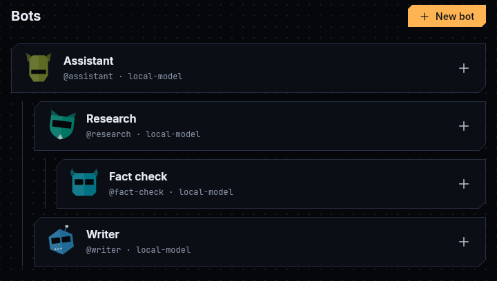
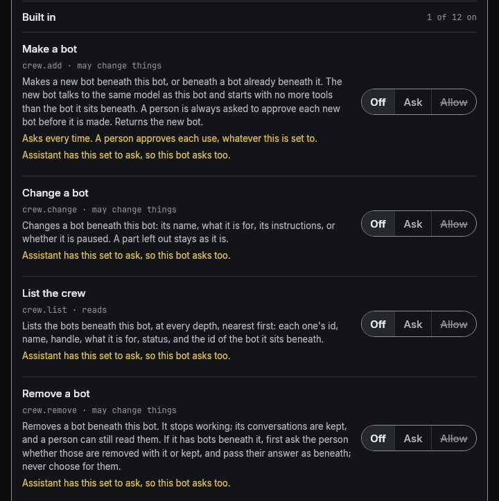
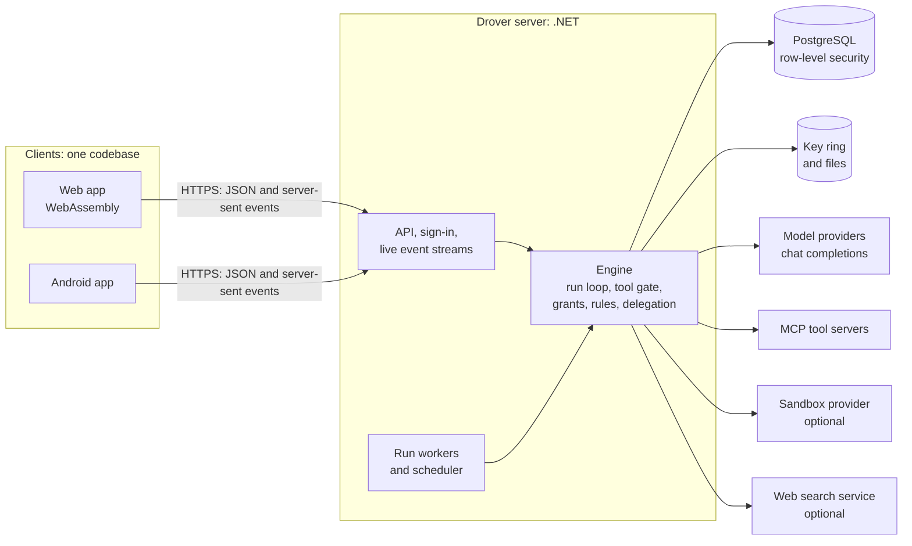

<p align="center">
  
</p>

<h1 align="center">Drover</h1>

<p align="center"><strong>Your own crew of AI bots, on your own server, under your own rules.</strong></p>

<p align="center">
  <a href="https://github.com/Forrest-Technologies/drover/actions/workflows/ci.yml"></a>
  <a href="LICENSE"></a>
  <a href="https://github.com/Forrest-Technologies/drover/releases"></a>
</p>

<p align="center">
  <a href="#quick-start">Quick start</a> ·
  <a href="#what-you-get-today">Features</a> ·
  <a href="#security-and-control">Security</a> ·
  <a href="#architecture">Architecture</a> ·
  <a href="#roadmap">Roadmap</a> ·
  <a href="docs/self-hosting.md">Self-hosting guide</a>
</p>

Drover is an open source platform for running AI bots that you host yourself. You give each bot a character, a model, a set of tools, and a place in a hierarchy. Bots chat with you, call tools over MCP, read and search the web, keep notes about what matters to you, run on a schedule, hand work to the bots beneath them, and, when you allow it, work in a sandbox computer of their own, with a terminal and an optional screen. The server decides what every bot may do. The model never does. It runs from one `docker compose up` on a machine you control, with your own model keys, and you reach it from a browser or the Android app.

<p align="center">
  <picture>
    <source media="(prefers-color-scheme: light)" srcset="docs/images/readme/conversation-light.png" />
    
  </picture>
</p>

## Why Drover exists

Hosted assistants are good at chat. They are also someone else's product: their defaults, their limits, their data retention, their idea of which tools you may connect. Drover is the other way around.

- **Complete from day one.** Streaming chat, tools, memory, files, schedules, delegation, sandboxes, and a phone app. Not a demo you have to finish yourself.
- **Real control.** Grants, rules, and policies decide what a bot can do, and you write them. Every limit is a setting you can read.
- **Truly open source.** Apache 2.0, the whole stack: server, engine, clients, and deployment files. Read it, fork it, change how it behaves.
- **Secure defaults, no needless limits.** Defaults are strict where a mistake costs you: other people's data and your keys. Network reach starts open, so local models and servers on your network just work, and one setting closes it. The rest is yours to tune.
- **Keeps moving.** New models, tools, and protocols are ported in as they appear, behind interfaces Drover owns, so a provider change stays in one place.

Owning the whole stack means you can build it to behave exactly how you want.

## What you get today

Everything in this section is on `main` now. Planned work is in the [roadmap](#roadmap).

### A crew, not a chatbot

- **A hierarchy of bots.** Every bot sits under the one that manages it. The crew list is how you get around: choose a bot and you are in its main conversation.
- **Delegation.** A bot hands a task to a bot beneath it and gets the answer back. You can open the delegated work and read it.
- **Bots that manage bots.** With the crew tools granted, a bot can list, make, change, and remove the bots beneath it. Making a bot always waits for a person.
- **Budgets on runaway work.** Each run has a cap on model calls and tokens. A delegation tree stops at a depth, a run count, and a cost the server sets (5 levels and 50 runs by default).
- **Characters, not profile pictures.** Each bot is a head with a visor that lights up while it thinks, writes, or runs a tool, and the same state is said in words.

### Conversations

- Streaming replies, with tool activity shown as it happens: arguments, output, and outcome.
- Edit an earlier message, or regenerate a reply.
- Side chats beside a bot's main conversation, and a running summary of the conversation.
- Search across your conversations. Save any conversation as Markdown or JSON.
- Attach files and pictures. PDF and office documents are read as text for the model. With a second domain set up, bot-written HTML opens in a preview on that separate site, away from your session.
- Projects group conversations around shared files.

### Tools

- **MCP tool servers.** Connect any MCP server with no auth, a header (stored encrypted), or a sign-in. A changed tool definition marks its grants for review.
- **Built-in tools.** Current time, read a web page, web search (through a search service you point it at), memory notes, image creation through the bot's model, delegation, and the crew tools.
- **Sandboxes (optional).** With a sandbox provider key configured, a bot gets its own machine: run commands, read and write files, and hand a file back to you. A sandbox with a screen adds computer use (look, click, type, scroll), and the bot can hand the screen to a person for anything only a person should do, such as a sign-in.
- **A sandbox page per bot.** See its state, watch its screen, open a terminal, and pause, resume, rebuild, or turn it off.

### Models and cost

- Use the built-in hosted provider, or any server that speaks the chat completions API, including one on your own machine or network.
- Fallback chains per space and per bot, so a failing model hands over to the next.
- Usage and cost per run and per bot, on the Usage screen.

### Memory, routines, rules, and extensions

- **Memory.** A bot saves notes per person. You can read, change, forget, and restore them from the conversation.
- **Routines.** Give a bot a prompt and a schedule (a cron expression and a time zone). Each run starts a new conversation or continues the same one.
- **Rules.** Per-bot rules that redact, ask, block, or stop (details under [security](#security-and-control)).
- **Extensions.** One JSON file adds a bot, a tool server, or both. You read what it holds before anything is added. A file can grant nothing, and its bot starts paused.

### Clients

- **Web.** One client compiled to WebAssembly, served by the server at `/`. Installable as an app, with browser notifications.
- **Android preview.** A signed APK on the [releases page](https://github.com/Forrest-Technologies/drover/releases), for Android 7 or later. Share text, links, pictures, and documents into Drover from other apps. Notifications through a push distributor you choose, with a reply action. See the [Android guide](docs/android-preview.md).
- Both are the same client code, talking to the same API. There is no web-only path.

## Security and control

Drover is built so that a bug in feature code cannot leak your data, and a clever prompt cannot widen what a bot may do.

| Concern | What Drover does |
| --- | --- |
| Isolation between people | Every row belongs to a space or a person, and PostgreSQL row-level security enforces it, not application code. The app's database role cannot bypass the policies. A test suite fails the build when a table has no policy. |
| What a bot may do | A tool with no grant is never sent to the model. A child bot never exceeds its parent. Every tool call passes a gate that reads the grant again at call time. |
| Human approval | A grant can be set to ask. The run waits until a person approves or denies the call. |
| Rules | Rules run at four points: a message arrives, before a tool, after a tool, and before a reply. They match on the tool, the kind of tool, text, built-in patterns (email addresses, card numbers, keys), time of day, or the size of the run. They redact, ask, block, or stop. |
| Untrusted text | Tool results, web pages, and tool descriptions are data. They never become instructions and never change a grant. |
| Secrets | Model keys, tool headers, and sign-ins are encrypted with a key ring on your server and never returned by any endpoint. Tool arguments and results are scrubbed of known secrets and common token shapes before they are stored. |
| Server policy | A deployment policy sets every limit: private network access, sandbox network and size, schedules, file sizes, delegation budgets, open registration. The self-hosted default is permissive for one trusted operator; a stricter preset locks every rule down. Limits only narrow: server, then space, then bot. |
| Accountability | Changes to bots, projects, extensions, and spaces go to an audit log that records the person, or the bot and the person it acted for. |
| Web hardening | Content Security Policy, HSTS, no framing, antiforgery tokens, and a sign-in rate limit. |
| Deployment | Containers run read-only, with every capability dropped and `no-new-privileges`. Database passwords are generated on first start. Drover listens on this machine only until you put HTTPS in front. |
| Supply chain | Every pull request runs CodeQL, secret scanning, dependency vulnerability and license checks, and workflow and Dockerfile linters. Actions are pinned to commit SHAs. Pull request code never runs on a self-hosted runner. |

The design behind each row is in [docs/architecture](docs/architecture/README.md), starting with [tenancy and permissions](docs/architecture/04-tenancy-and-permissions.md), [auth and secrets](docs/architecture/08-auth-and-secrets.md), and [deployment policies](docs/architecture/16-deployment-policies.md). To report a vulnerability, see [SECURITY.md](SECURITY.md).

## A closer look

<table>
  <tr>
    <td width="50%" valign="top">
      
      <p><strong>The crew.</strong> Every bot sits under the one that manages it. A bot's authority reaches only the bots beneath it.</p>
    </td>
    <td width="50%" valign="top">
      
      <p><strong>Rules and limits.</strong> Starter rules ask before anything that writes, block card numbers and keys, or set quiet hours. Each bot shows the limits it runs under: model calls, tokens, and handoffs.</p>
    </td>
  </tr>
  <tr>
    <td colspan="2" valign="top">
      <picture>
        <source media="(prefers-color-scheme: light)" srcset="docs/images/readme/tool-grants-light.png" />
        
      </picture>
      <p><strong>Grants.</strong> Each tool is Off, Ask, or Allow, per bot. A bot can never be allowed more than the bot above it, and the editor says why a choice is not available.</p>
    </td>
  </tr>
</table>

Every screenshot here is the web client built from `main`, running locally with a throwaway account.

## Quick start

You need Docker with Compose. The image builds from source on your machine. CI builds it inside a 2 GB memory budget on every change, so a small server is enough.

```sh
git clone https://github.com/Forrest-Technologies/drover.git
cd drover
docker compose up --build
```

The log prints a one-time setup code. Open [localhost:8080/setup](http://localhost:8080/setup), enter the code, create your account, and connect a model. Compose creates the database passwords on first start and keeps them in Docker volumes. Drover listens on this machine only.

**Connect a model.** Pick the built-in provider and paste a key, or choose Compatible endpoint and give the base address of any server that speaks the chat completions API. A key is optional for a compatible endpoint. Test connection reports the result in words. The key is stored encrypted and never shown again.

**Connect a tool server.** Open Tool connections (`/tools`), add a server's MCP address, and choose how Drover proves who is calling: nothing, a header, or a sign-in. Then grant its tools to a bot in the bot editor (`/bots`). A bot never gets a tool it has no grant for.

**Reach it from another device.** Point a domain at the machine, open ports 80 and 443, and start Drover with the HTTPS proxy in front:

```sh
DROVER_DOMAIN=drover.example.org docker compose -f compose.yaml -f compose.proxy.yaml up --build
```

**Upgrade** by checking out a newer commit and running the same command. Migrations apply before the server starts. `docker compose down` keeps your data. Only `docker compose down --volumes` deletes it.

**Back up** the database, key ring, files, and secrets volumes together. A database copy without the key ring cannot read your stored keys.

Sandboxes, web search, HTML previews, your own proxy, backup and restore, and moving to another machine are in the [self-hosting guide](docs/self-hosting.md).

<details>
<summary>Build and test from source with the .NET 11 SDK</summary>

```sh
dotnet build Drover.slnx -warnaserror
dotnet test --solution Drover.slnx
dotnet publish src/Drover.Native -f net11.0-browserwasm -p:DroverNativeTargetFrameworks=net11.0-browserwasm -c Release -o artifacts/native
NativeClient__Path=artifacts/native/wwwroot dotnet run --project src/Drover.Server
```

The server serves the browser client from the folder `NativeClient__Path` names. Publishing it needs the `wasm-tools` workload. The other client targets are in [the native client guide](docs/architecture/18-native-client.md). The browser tests in `Drover.Presentation.Tests` need a Chromium-based browser installed, or `DROVER_TEST_CHROMIUM` set to one.

</details>

## Architecture



- **The server owns the work.** A run is a durable job with a stored event log. Clients send intent and render state, and a dropped stream resumes where it left off.
- **Permissions live outside the model.** Grants narrow down the bot tree and are checked at call time, so a prompt injection can only reach what the bot was already allowed to do.
- **Isolation lives in the database.** Identity is set per transaction, and a missing identity returns zero rows.
- **Providers sit behind Drover's own interfaces.** Models, tools, sandboxes, search, push, files, and secrets each have their own adapter project, so adding or swapping a provider touches one place.
- **Stateless servers.** Short transactions, and runs that resume from stored state, so any instance can pick up any work after a restart.

Read more: [solution layout](docs/architecture/01-solution-layout.md), [run lifecycle](docs/architecture/03-run-lifecycle.md), [MCP](docs/architecture/06-mcp.md), [sandboxes](docs/architecture/07-sandbox.md), [agent framework](docs/architecture/14-agent-framework.md), [native client](docs/architecture/18-native-client.md), and the [decision records](docs/adr/README.md).

## Roadmap

Everything above ships today. What comes next is planned in [docs/roadmap.md](docs/roadmap.md), with each piece of work filed as an issue under the [roadmap label](https://github.com/Forrest-Technologies/drover/issues?q=label%3Aroadmap), grouped into milestones. The issue is the source of truth for its status. The phases Drover is working through are in [ROADMAP.md](ROADMAP.md).

## Contributing

Drover is early and moving fast. Issues are the source of truth for work: pick one whose acceptance criteria you can meet, and open one pull request for it.

Read these first:

- [AGENTS.md](AGENTS.md): the rules you cannot learn from the code, such as tenancy, permissions, and secrets.
- [CODE_STYLE.md](CODE_STYLE.md): the C# style guide. The build enforces most of it.
- [DESIGN.md](DESIGN.md): the interface direction, and the list of things the interface never does.
- [docs/architecture](docs/architecture/README.md) and [docs/adr](docs/adr/README.md): how it fits together, and why.

Report security problems privately, as described in [SECURITY.md](SECURITY.md).

## License

Apache License 2.0. See [LICENSE](LICENSE) and [NOTICE](NOTICE).
