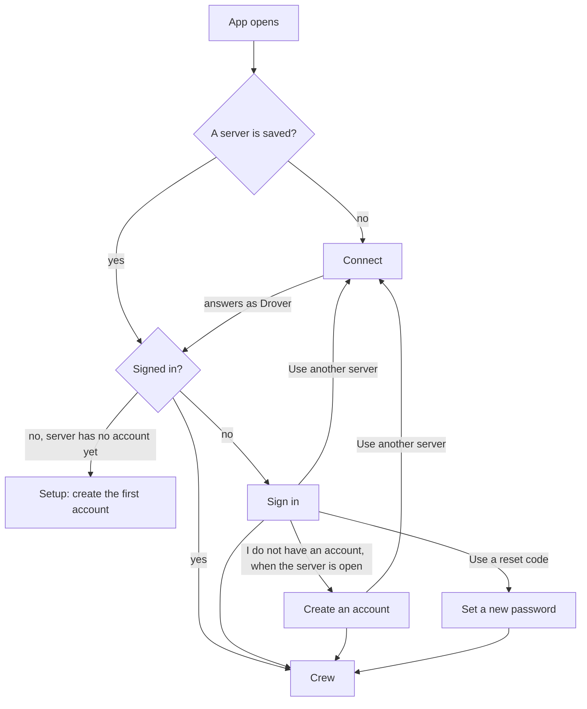

# First run: connect, create an account, change a password

Issues: #592 (Connect), #583 (Create an account on an open server), #584 (Change password and reset codes).

Wording follows the [copy guide](copy-guide.md).

These are entry screens. They use `EntryLayout`: one column, at most 440 px, centered on the yard. No screen here adds a "confirm password" field.

## Flow



The browser build has no Connect screen: it talks to the server that served it.

## 1. Connect (#592)

**The screen's job:** tell this app which Drover server to use.

```text
+--------------------------------------+
|              (Drover mark)           |
|  Connect to your server              |
|  Drover runs on a server you or      |
|  someone you know hosts.             |
|                                      |
|  +--------------------------------+  |   shown on a desktop only, when
|  | Drover is running on this      |  |   a server answers on this computer
|  | computer.          [ Use it ]* |  |
|  +--------------------------------+  |
|                                      |
|  Server address                      |
|  |______________________________|    |
|  It looks like drover.example.org    |
|                                      |
|  (!) {problem sentence}              |
|                                      |
|            [ Connect ]*              |
+--------------------------------------+
```

Components: `DroverMark`, heading (20 px, weight 600), one line of `text-2`, an optional `Facet` card (10 px cut, `bg-2`) holding a sentence and a `Button`, one `Field` (`Type` url, label `Server address`, hint `It looks like drover.example.org`, autocorrect and capitals off), a `StatusNote` (`Danger`, `AutomationId` `ConnectProblem`), one `Button`.

When the card shows, `Use it` is the primary button and `Connect` is `Quiet`. Otherwise `Connect` is primary.

### What the field accepts

The app fixes what was typed. It does not refuse it.

| Typed | Tried |
| --- | --- |
| `drover.example.org` | `https://drover.example.org` |
| `https://drover.example.org/bots?x=1` | `https://drover.example.org` |
| `http://drover.example.org` | `https://drover.example.org` |
| `user:pass@drover.example.org` | `https://drover.example.org`. The name and password are dropped and never stored or logged |
| `localhost:8080` on a desktop | `https://localhost:8080`, then `http://localhost:8080` |
| `http://localhost:8080` on a desktop | as typed |

Once connecting starts, the field shows the address in use.

### States and words

| State | Words | Notes |
| --- | --- | --- |
| First open | field empty, no note | Focus in the field |
| Returning after "Use another server" | the address that was left, selected | #576 |
| A server on this computer answered | card: `Drover is running on this computer.` and `Use it` | Asked once, 1 second limit. No answer shows nothing |
| Empty and Connect pressed | `Enter the address of your Drover server.` | |
| Not an address | `That is not a server address. It looks like drover.example.org.` | |
| Connecting | button reads `Connecting to {host}`, field and button disabled | polite live region |
| Typed `http://` to another machine, and HTTPS did not answer | `{host} did not answer over HTTPS. This app connects to another machine only over HTTPS, so your password is not readable on the network. Put the server behind HTTPS and use that address.` and the link `How to serve Drover over HTTPS` | The link opens the self-hosting guide outside the app |
| Certificate not trusted | `This device does not trust the certificate of {host}. Add the certificate, or the authority that issued it, to this device, then try again.` | |
| Name not found | `No server was found at {host}. Check the spelling, and that this device is on the right network.` | |
| Refused | `{host} did not accept the connection. Check that Drover is running and that the port is right.` | |
| Timed out | `{host} did not answer within 15 seconds. Check the network, then try again.` | |
| Answered, but not as Drover | `{host} answered, but not as a Drover server. Check the address.` | |
| Anything else | `{failure sentence}` | |
| The app is too old for this server | the Update screen in `app-updates-and-ios.md` | #513 |

After a failure, focus returns to the field with its text selected. Offline is the "Name not found" or "Timed out" state. There is no separate offline screen here.

## 2. Create an account (#583)

**The screen's job:** make an account on a server that takes new ones.

```text
+--------------------------------------+
|  Create an account                   |
|  You are making an account on        |
|  drover.example.org.                 |
|                                      |
|  Your name  |____________________|   |
|  Email      |____________________|   |
|  Password   |____________________|   |
|  At least 12 characters.             |
|                                      |
|  [ ] I accept the terms of service,  |
|      version 3      Read the terms   |
|                                      |
|  (!) {problem sentence}              |
|         [ Create account ]*          |
|                                      |
|  I already have an account           |
|  This app is connected to            |
|  drover.example.org.                 |
|  Use another server                  |
+--------------------------------------+
```

Components: heading, the server line (devices only), three `Field`s (`Your name`; `Email`, type email, autofill `username`; `Password`, type password, autofill `new-password`, hint `At least 12 characters.`), a `Switch` with the label `I accept the terms of service, version {v}` and a `Link` `Read the terms` (shown only when the server sends them), a `StatusNote` (`Danger`), a `Button`, a `Link` `I already have an account`, and `ServerChoice` on a device.

| State | Words |
| --- | --- |
| Checking the server | `Checking this server.` in place of the form |
| Open | the form |
| The terms switch is off | `Create account` is disabled. Its accessible description: `Accept the terms to continue.` |
| Sending | button reads `Creating your account`, fields disabled |
| The server takes no new accounts | `EmptyState`: title `This server is not taking new accounts`, cause `Ask its operator for one, or sign in.`, action `Sign in` |
| The server needs a verified email and cannot send one | `This server asks for a verified email and cannot send email yet. Ask its operator for an account.` |
| Refused | the server's sentence under the form. Every value is kept except the password |
| Too many tries, or unreachable | `{failure sentence}`, form kept |
| Already signed in | go to the crew |

On Sign in, the link `Create an account` shows only when the server says it takes new accounts.

## 3. Change password (#584)

Account menu, a new item `Change password` after `Notifications`. It opens a `Dialog`.

```text
+--------------------------------------+
|  Change password                     |
|                                      |
|  Current password |______________|   |
|  New password     |______________|   |
|  At least 12 characters.             |
|                                      |
|  (!) {problem sentence}              |
|  [ Keep password ] [ Change password ]* |
+--------------------------------------+
```

| Outcome | What happens |
| --- | --- |
| Changed | the dialog closes. Toast (`Success`): `Password changed. Your other devices were signed out.` |
| Refused | the server's sentence under the fields. What was typed is kept. Focus on `Current password` |
| The current password was wrong too many times | the dialog closes, the session ends, Sign in opens with the toast (`Warning`): `The current password was wrong too many times, so you were signed out. Sign in again.` |
| Too many tries, or unreachable | `{failure sentence}`, fields kept |
| Sending | button reads `Changing`, fields disabled |

Both fields are cleared when the dialog closes, however it closes. Below 560 px the two buttons stack, `Change password` first.

## 4. Set a new password with a reset code (#584)

Sign in gains the link `Use a reset code`, always shown.

```text
+--------------------------------------+
|  Set a new password                  |
|  The operator of this server can     |
|  make a one-time reset code for your |
|  account. Enter it here with a new   |
|  password.                           |
|                                      |
|  Email        |__________________|   |
|  Reset code   |__________________|   |
|  New password |__________________|   |
|  At least 12 characters.             |
|                                      |
|  (!) {problem sentence}              |
|          [ Set password ]*           |
|  Back to sign in                     |
+--------------------------------------+
```

`Reset code` uses the machine font, with autocorrect, capitals and suggestions off.

| Outcome | What happens |
| --- | --- |
| Set | the person is signed in with what they just typed and lands on the crew. Toast (`Success`): `Password changed.` |
| Set, but the sign-in that follows fails | Sign in opens with the toast (`Info`): `Password changed. Sign in with the new one.` |
| Refused | the server's sentence. What was typed is kept |
| Too many tries, or unreachable | `{failure sentence}` |
| Sending | button reads `Setting your password` |

Nothing typed on this screen is put in an address or kept after the screen is left.

## 5. The notifications offer after setup (#592)

Shown once, above the message field of the first bot's conversation, after setup.

```text
+----------------------------------------------+
| Get told when {bot} finishes or is waiting   |
| for you.                                     |
|      [ Turn on notifications ]*  [ Not now ] |
+----------------------------------------------+
```

A `Facet` card (10 px cut, `bg-2`), a named group `Notifications`. Either button removes the card for good on this device. Shown in a published browser build and on Android. Not shown on a desktop, where delivery is live while the app runs. When turning them on fails, the card stays and shows the existing sentence from `DevicePushViewModel` under the buttons.

## Layout at each width

- Below 600 the column fills the width with 16 px padding. At 600 and wider it is 440 px wide and centered.
- No screen here scrolls sideways with a 60 character host name. The host wraps.

## Light and dark

Tokens only. The problem note uses `danger` with its icon. The primary button is `ember`. The card on Connect and the offer card use `bg-2` and `line`. Screenshots of Connect in every state, Create an account in every state, both password flows, and the offer card, dark and light, at 360 px and at 1280 px.

## Accessibility

- Each screen has one level 1 heading, its title.
- Focus order is top to bottom: the card's button when shown, the fields, the terms switch and link, the submit button, the links below.
- A problem note is an assertive live region and is tied to the field it is about (`Error` on the `Field`) when it is about one field.
- Autofill hints: `username` on Email, `current-password` and `new-password` on the password fields, `one-time-code` is not used for a reset code (it is not a message code).
- Enter submits from any field. Escape closes the Change password dialog.
- Automation ids from #584 are kept: `PasswordCurrent`, `PasswordNew`, `PasswordSubmit`, `ResetEmail`, `ResetCode`, `ResetNew`, `ResetSubmit`.

## Settings and defaults

| Element | Default | Setting (stored name) | Location | Label |
| --- | --- | --- | --- | --- |
| The notifications offer after setup | Shown once per device | The device setting #592 adds for it, set by either button | None. It is answered on the card. Notifications themselves are in Settings, Notifications | `Turn on notifications`, `Not now` |

Nothing else here is optional.

## Acceptance checks

- [ ] Every row of "What the field accepts" is a case of one test of the address reader.
- [ ] Every sentence in the Connect table appears exactly as written, and each failure class has a test that produces it.
- [ ] A name and password typed into the address never reach a request, a setting or a log (a test asserts each).
- [ ] Create an account keeps every value except the password after a refusal.
- [ ] The password dialog's fields are empty when it is opened a second time.
- [ ] The reset screen leaves nothing in the address bar or the history in the browser build.
- [ ] All four screens pass the shared screen checks at 360 px, dark and light, with accessible names on every control.
