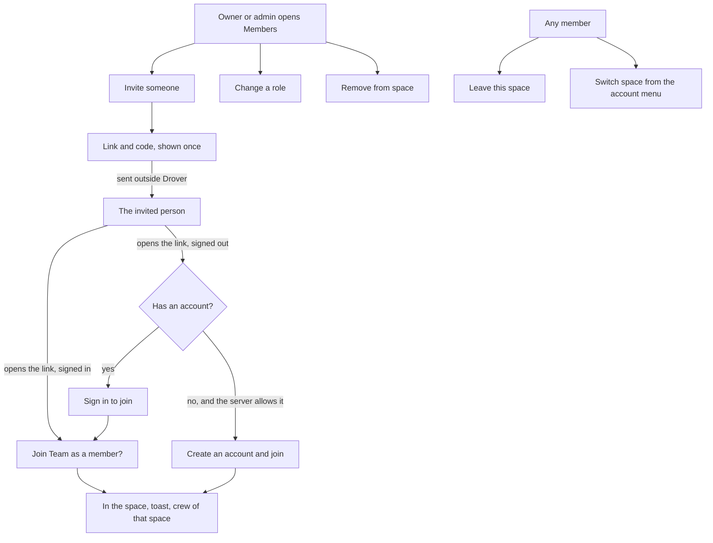

# Members and spaces

Issues: #517 (invite, roles, remove, leave: the server), #518 (the Members screen and joining), #591 (switch between spaces), #523 (name, email, time zone).

Wording follows the [copy guide](copy-guide.md).

Sam and Team in the wireframes are samples.

## Flow



## 1. Members (#518)

**The screen's job:** see who is in this space, and change who is.

Navigation entry `Members`, beside Usage and Status. Address `/members`.

```text
360 px                                     900 px and wider
+--------------------------------------+   +----------------------------------------------------+
| Members           [ Invite someone ]*|   | Members                        [ Invite someone ]* |
| Team                       [ Rename ]|   | Team                                    [ Rename ] |
|                                      |   |                                                    |
| Sam (You)                            |   | Sam (You)          Owner            Joined 3 Nov   |
|   Owner · Joined 3 Nov               |   | Robin              v Admin          Joined 9 Nov  ...|
| Robin                                |   | Lee                v Member         Joined 12 Nov ...|
|   v Admin · Joined 9 Nov         ... |   |                                                    |
| Lee                                  |   | Waiting to be used                                 |
|   v Member · Joined 12 Nov       ... |   | Member · made by Sam · runs out 30 Nov  [ Revoke ]  |
|                                      |   |                                                    |
| Waiting to be used                   |   | [ Leave this space ]                               |
| Member · made by Sam ·               |   +----------------------------------------------------+
|   runs out 30 Nov        [ Revoke ]  |
|                                      |
| [ Leave this space ]                 |
+--------------------------------------+
```

Components: heading, `Button` `Invite someone` (`Primary`), the space name with `Rename` (`Quiet`, owners), the list (one row per person), a `Select` per row for the role where the viewer may change it, a `Menu` per row (`IconButton`, label `More for {name}`) with `Remove from space`, a second list `Waiting to be used`, and `Leave this space` (`Quiet`) at the foot.

- The deciding column is first: the person, then the role, then when they joined.
- Rows are sorted owners, then admins, then members, each by name.
- The viewer's own row shows `(You)` after the name and has no role select and no menu.

### Who sees what

| Control | Shown to |
| --- | --- |
| Role `Select` on a row (`Owner`, `Admin`, `Member`) | Owners, on every other row. Admins, on rows that are not owners, without the `Owner` option |
| `Remove from space` | Owners, on every other row. Admins, on rows that are not owners |
| `Invite someone` | Owners and admins |
| `Waiting to be used` list and `Revoke` | Owners and admins |
| `Rename` | Owners |
| `Delete this space` (in the foot, `Danger`) | Owners, in a shared space (#520) |
| `Leave this space` | Everyone, in a shared space |

A control the viewer may not use is not drawn. It is not shown disabled. A member sees a plain list and `Leave this space`.

### States and words

| State | Words |
| --- | --- |
| Loading | `Loading the members.` |
| Failed | `EmptyState`: title `Members could not be loaded`, cause `{failure sentence}`, action `Try again` |
| A personal space | `Only you are here.` and `Invite someone` |
| No pending invitations | the `Waiting to be used` heading and list are not drawn |
| Role changed | toast (`Success`): `{name} is now {role}.` Focus stays on the select |
| Role change refused | the select returns to the old value. `StatusNote` (`Danger`) under the row: the server's sentence |
| The last owner tries to change their role or leave | the server's sentence: `A space needs an owner. Make someone else an owner first.` |
| You were removed while the app is open | the app moves to your first remaining space. Toast (`Info`): `You are no longer in {space}.` |

### Dialogs

| Dialog | Title | Body | Buttons |
| --- | --- | --- | --- |
| Invite | `Invite someone` | `SegmentedControl` `Role`: `Member` (default), `Admin`. In a personal space one more line: `Inviting someone makes this space shared. Your conversations stay private until you share them. Running sandboxes are replaced.` | `Cancel`, `Create invitation` (`Primary`) |
| Invitation made | `Invitation made` | `Send this link to the person you are inviting. It works once, for 7 days, and is shown only now.` Then the link in a read-only `Field` with `Copy link` (`Primary`), and under it the code in the machine font with `Copy code` (`Quiet`) | `Done` |
| Remove | `Remove {name} from this space?` | `Their routines stop and their running work is cancelled. Their private conversations are kept, hidden, and come back if you invite them again.` | `Cancel` (focused), `Remove` (`Danger`) |
| Leave | `Leave this space?` | `You lose access to its bots and conversations at once. Your routines here stop.` | `Cancel` (focused), `Leave` (`Danger`) |
| Rename | `Rename this space` | `Field` `Name` | `Cancel`, `Save` (`Primary`) |
| Delete (#520) | `Delete {space}?` | `Everything in this space is deleted for everyone in it: bots, conversations and files. This cannot be undone.` Then `Field` `Type the space's name` | `Cancel` (focused), `Delete space` (`Danger`, enabled when the name matches) |

`Revoke` on a pending invitation is one press, with a toast (`Info`): `Invitation revoked.` A revoked code cannot come back, so no undo is offered. The person can make a new invitation.

`Copy link` and `Copy code` each answer with a toast (`Success`): `Copied.` When copying fails: `Could not copy. Select the text and copy it yourself.` and the text is selected.

Closing the "Invitation made" dialog is final: the link and code are not shown again. The dialog says so in its first sentence, so no second prompt asks.

## 2. Joining (#518)

| Where | What the person sees |
| --- | --- |
| Signed in, account menu | A new item `Join a space`. A `Dialog` with one `Field`, `Invitation link or code`, and `Continue` |
| After the code is read | `Join {space} as a {role}?` with `Cancel` and `Join` (`Primary`) |
| Joined | the app switches to that space. Toast (`Success`): `You are now in {space}.` |
| Signed out, opened from a link | Sign in shows a `StatusNote` (`Info`) above the form: `You were invited to {space}. Sign in to join.` and, when the server allows it, the link `Create an account and join` |
| Signed out, no link | Sign in has the link `I have an invitation code`, which asks for the code first |
| A code that is not valid | `That code is not valid. It may have been used or run out.` One sentence for every such case |
| Already a member | `You are already in {space}.` with `Open {space}` |

The code travels in the address fragment, so it is not sent to the server in the request for the page. The app removes it from the address as soon as it has read it.

## 3. Switching space (#591)

Shown only when the person belongs to more than one space.

```text
Account menu                      Sheet: Your spaces
+--------------------------+      +--------------------------------------+
| Team                     |      |  Your spaces                     [x] |
| Admin of this space      |      |                                      |
|--------------------------|      |  Sam's space                         |
| Notifications            |      |  Your own space · Owner              |
| ...                      |      |                                      |
+--------------------------+      |  Team                                |
                                  |  Shared · Admin · You are here       |
                                  +--------------------------------------+
```

- The account menu's first item is the current space: its name, with the caption `Your space` for a personal one or `{role} of this space` for a shared one. It opens the sheet.
- At 900 px and wider the bar also shows the space name beside the wordmark, as text.
- The sheet lists one row per space: the name, then `Your own space` or `Shared`, then the role. The personal space is first. The current one is marked `You are here` and is not a button.

| Case | Behavior |
| --- | --- |
| A row is chosen | the app switches at once: the crew of that space loads, focus is on the crew. Toast (`Info`): `You are now in {space}.` |
| The bot editor or the extension editor holds unsaved work | the leave dialog from `recovery-states.md`, section 5, asks first |
| A message is half written and drafts are not kept yet | `Dialog`: title `Switch to {space}`, body `What you are writing in this space is not sent yet and will be dropped.`, buttons `Stay here` (focused), `Switch` |
| An address from another space is opened | the existing `This bot is not here` notice gains a second action, `Switch space`, which opens the sheet |
| The spaces could not be read | the sheet shows `Your spaces could not be loaded. {failure sentence}` and `Try again` |

## 4. Your name, email and time zone (#523)

Two rows on the Settings screen (#600), group `You`.

| Row | Control | Words |
| --- | --- | --- |
| `Name` | a `Field` that saves on Enter or when focus leaves | saved: polite announcement `Name saved.` Refused: `A display name of up to 200 characters is required.` |
| `Email` | the email as text, with `Change email` (`Quiet`) | opens the dialog below |
| `Time zone` | a `Select` of the device's zone first (`{zone} (this device)`), then all zones by region | saved: `Time zone saved.` Refused: `That is not a time zone this server knows.` |

The `Change email` dialog: title `Change email`, `Field` `New email`, `Field` `Current password`, buttons `Keep email`, `Change email` (`Primary`).

| Outcome | Words |
| --- | --- |
| Changed | the dialog closes. Toast (`Success`): `Your email is now {email}.` |
| Wrong password | under the password field: `The current password is not right.` |
| The address cannot be used | under the email field: `That email cannot be used.` |
| The server needs a verified email and cannot send one | `Changing your email needs email verification, and this server cannot send email yet.` |
| Too many wrong passwords | the session ends, as in `recovery-states.md`, section 3 |

## Layout at each width

- Below 900 px a member row is two lines: the name, then role and joined date, with the menu at the end of the second line.
- Dialog buttons stack below 560 px, the safe answer first.
- The sheet opens from the bottom below 640 px.

## Light and dark

Tokens only. Roles are text, not colored badges: a role is not a state. `Danger` is used only on the confirming buttons of Remove, Leave and Delete. Screenshots of Members for an owner, an admin and a member, each dialog, the join steps, the sheet, dark and light, at 360 px and 1280 px.

## Accessibility

- Members is one list named `Members`. A row's accessible name is `{name}, {role}, joined {date}`, with `, you` on the viewer's own row.
- The role select's name is `Role of {name}`.
- Focus order: `Invite someone`, `Rename`, the rows (name, role, menu), the pending list, `Leave this space`.
- The invitation link and code are selectable text in addition to the copy buttons.
- In every confirming dialog the safe answer has focus and Escape chooses it.
- After a removal, focus goes to the next row, or to `Invite someone` when none is left.
- A role change by another admin while the screen is open updates the row and is announced politely: `{name} is now {role}.`

## Settings and defaults

| Element | Default | Setting (stored name) | Location | Label |
| --- | --- | --- | --- | --- |
| The space name beside the wordmark in the bar, at 900 px and wider | Shown when the person belongs to more than one space | None. It follows the number of spaces | | |

This spec adds no extra that needs a switch. The chosen space is remembered on the device as `drover.space`.

## Acceptance checks

- [ ] A member sees no role select, no menu, no `Invite someone` and no pending list, and the client makes no request it would be refused.
- [ ] The invitation link and code are shown once: reopening Members shows the pending row and no code.
- [ ] The code never appears in a request address or a log (a test reads both).
- [ ] After a switch of space, no request names the old space (a test records the requests).
- [ ] Every sentence in this file appears exactly as written.
- [ ] Each dialog's safe answer is focused and Escape chooses it.
- [ ] All screens pass the shared screen checks at 360 px, dark and light.
