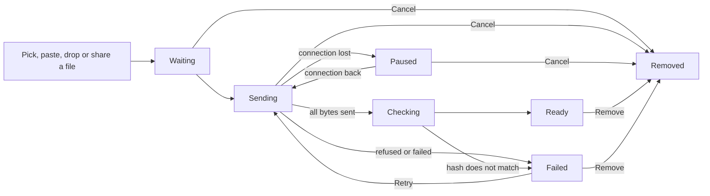

# Uploads in the composer

Issues: #844 (the chip states), #821 (chunked uploads), #814 and #836 (the notices for a share or a paste that could not be attached).

Wording follows the [copy guide](copy-guide.md).

**The screen's job:** show which files will go with the next message, and how far each one is.

## Flow



1. A person adds one or more files. Each becomes a chip above the message field at once.
2. At most three files upload at a time. The rest wait.
3. The person can keep typing. Send stays disabled until every chip is Ready, or removed.
4. A lost connection pauses the upload. It continues by itself from where the server says it stopped.
5. A failure keeps the chip, says why, and offers Retry where a retry can work.

## The chip

One chip per file, in the `FlowPanel` of `AttachmentTray` above the message field, in the order added. A chip is a `Facet` (6 px cut, fill `bg-2`, 1 px `line`), 44 px high where the pointer is coarse and 32 px otherwise, at most 280 px wide. At 360 px a chip takes the full row.

```text
+--------------------------------------------------+
| [icon] holiday-video.mov              [ Cancel ] |
|        Sending · 12.4 MB of 96 MB                |
| ============--------------------------------     |
+--------------------------------------------------+
```

- Line 1: a file-kind icon (decorative, no name), the file name in `text`, cut in the middle with an ellipsis when long so the extension stays visible, then one `IconButton`.
- Line 2: the state sentence in `text-2`, 12 px.
- Progress line: 2 px along the bottom edge inside the facet, `ember` on `line`, drawn only in Sending and Paused when the total size is known. It does not animate between updates and never loops.

### States and words

| State | Line 2 | Progress line | Button (accessible name) |
| --- | --- | --- | --- |
| Waiting | `Waiting to send` | none | Cancel (`Cancel {file name}`) |
| Sending, size known | `Sending · {sent} of {total}` | filled to sent ÷ total | Cancel (`Cancel {file name}`) |
| Sending, size not known | `Sending · {sent} sent` | none | Cancel (`Cancel {file name}`) |
| Paused | `Paused. It continues when the connection is back.` | kept where it stopped, `text-3` in place of `ember` | Cancel (`Cancel {file name}`) |
| Checking | `Checking the file` | full | none |
| Ready | `{total}` | none | Remove (`Remove {file name}`) |
| Failed, can retry | `Not uploaded. {cause}` in `danger`, with a danger icon named "Failed" | none | Retry (`Try {file name} again`), then Remove |
| Failed, cannot retry | `Not uploaded. {cause}` in `danger`, with the same icon | none | Remove (`Remove {file name}`) |

Sizes use the largest unit that keeps one decimal below 100 (`840 KB`, `12.4 MB`, `1.2 GB`), with the device's number format.

### Causes

`{cause}` is one of these fixed sentences. Nothing from a response body, a header or an upload id is shown.

| Cause | Sentence | Retry |
| --- | --- | --- |
| The file is larger than the server takes | `It is larger than {limit}, the most this server takes.` | no |
| The person's or the space's storage is full | `There is no room left for files. Remove some files, or ask the owner of the space.` | no |
| The kind of file is not accepted | `This kind of file cannot be attached.` | no |
| The file could not be read on the device | `This device could not read the file.` | yes |
| The server did not answer, after the retries | `{failure sentence}` | yes |
| The file changed or was damaged on the way | `The file did not arrive whole.` | yes |
| The upload ran out of time on the server | `It took too long and was dropped.` | yes |
| The session ended | handled by the session screen (#562); the chip is kept for the return |

## The composer around the chips

- While any chip is Waiting, Sending, Paused or Checking, Send is disabled. Its accessible description is `Send is ready when the files have uploaded.` The same sentence shows as a `StatusNote` (`Info`) under the chips only after the person presses Enter or Send while it is disabled, and leaves when the last upload ends.
- While any chip is Failed, Send is enabled only if at least one other chip is Ready or the field has text, and the message goes without the failed files. Before it goes, a `Dialog` asks once: title `Send without {n} files`, body `{n} files were not uploaded and will not go with this message.`, buttons `Go back` (focused) and `Send without them`. With one file: `Send without 1 file` and `1 file was not uploaded and will not go with this message.`
- Stop, the message field and Attach work as today.

## A share or a paste that could not be attached

| Case | Where | Words |
| --- | --- | --- |
| Some shared items could not be read (#814) | A `StatusNote` (`Danger`) above the chips of the conversation the share went to | `{n} of {total} shared items could not be read and were left out.` With one: `1 of {total} shared items could not be read and was left out.` |
| No shared item could be read (#814) | A toast, `Error` | `Nothing that was shared could be read.` |
| A shared file is larger than the server takes (#814) | Its chip, Failed, cannot retry | the size cause above. The file is not copied whole first |
| A pasted picture is too large to hold (#836) | A toast, `Error`, on the conversation the paste was made in, never on another one | `That picture is too large to paste. Save it as a file and attach it.` |

## Layout at each width

- Below 560: chips stack, one per row, full width. The dialog's buttons stack, `Go back` first.
- 560 and wider: chips wrap in rows.
- The chip row never pushes the message field off screen: with more than four rows of chips the chip area scrolls inside itself, at most 196 px high, and the newest chip is scrolled into view when added.

## Light and dark

Tokens only: `bg-2` fill, `line` edge, `text`, `text-2`, `ember` progress, `danger` for a failure sentence and icon. The paused progress line uses `text-3`. In light, `ember` is the dark amber and still clears 3:1 against `line` as a graphic.

## Accessibility

- The chip area keeps its name, `Files attached to this message` (`AttachmentTray`). Each chip is a list item whose name is `{file name}, {line 2}`.
- Focus order: chips in order, each chip's buttons left to right, then the message field.
- Removing or cancelling a chip moves focus to the next chip's first button, or to the message field when none is left.
- Progress is announced politely at 25, 50, 75 and 100 percent and no more often than once every 5 seconds: `{file name}, {percent} percent`. With no known size nothing is announced until Ready.
- Paused, Failed and Ready are announced once each: `{file name}, paused`, `{file name}, not uploaded, {cause}`, `{file name}, uploaded`.
- The progress line is decorative to a screen reader. The numbers in line 2 carry the same fact.

## New pieces

- The chip that `AttachmentTray` draws gains the two-line form, the progress line and the Retry button. No new control.
- Gallery: one sample of each state, marked as samples.

## Settings and defaults

This spec adds no optional element. Upload progress is part of sending a file and is always shown. Nothing here has a switch.

## Acceptance checks

- [ ] Each state in the table is drawn with its exact words in dark and light at 360 px, and in the gallery.
- [ ] A file with no known size never shows a percentage or a progress line.
- [ ] Nothing in the chip animates in a loop (`NativeInterfaceRuleTests`, the looping-animation rule).
- [ ] With a screen reader, a large upload is announced at most five times before Ready.
- [ ] Cancel and Remove never leave focus on nothing.
- [ ] A long file name keeps its extension visible at 360 px.
- [ ] `tests/Drover.Presentation.Tests`: one test per row of the states table asserts line 2 and the button names.
